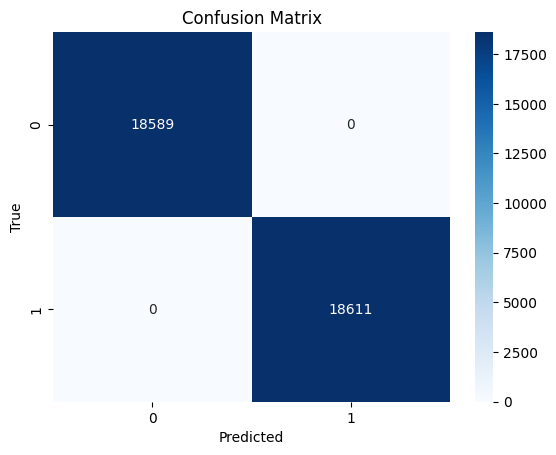
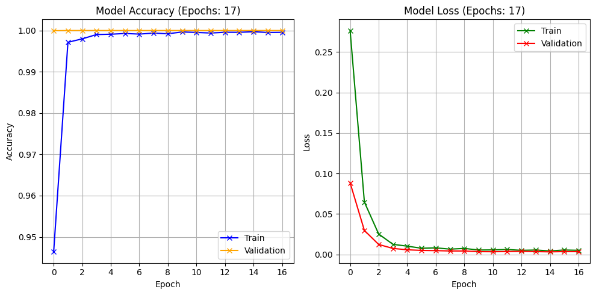

# Intrusion Detection System with CNN-LSTM Architecture

[](https://colab.research.google.com/github/FranPratama/Intrusion-Detection-System-with-Hybrid-CNN-LSTM/blob/main/Corrected_TA_IDS.ipynb)
[](https://colab.research.google.com/github/FranPratama/Intrusion-Detection-System-with-Hybrid-CNN-LSTM/blob/main/Original_Journal_Version_TA_IDS.ipynb)

> **Important Note on Versions:**
> There are two versions of the notebook in this repository:
> 1. `Corrected_TA_IDS.ipynb`: The version with corrected Machine Learning methodology. This resolves the *Data Leakage* issue by removing the `attack_cat` feature and performing the *train-test split* **before** *upsampling*. (Highly recommended for further experiments).
> 2. `Original_Journal_Version_TA_IDS.ipynb`: The original version used and published in the Jurasik Journal. The 99.99% accuracy in this version is caused by *target leakage* and data leakage during *upsampling* (kept for educational purposes).

> **Note:**

> This project is submitted in partial fulfillment of the requirements for a Bachelor of Computer Science. The proposed architecture was implemented and evaluated using the UNSW-NB15 dataset, with all computational experiments conducted on Google Colab utilizing a T4 GPU acceleration environment.
> 
> The findings of this research have been formally published in Jurasik (Jurnal Riset Sistem Informasi dan Teknik Informatika) and can be accessed via [this link](https://tunasbangsa.ac.id/ejurnal/index.php/jurasik/article/view/895).
>
> The UNSW-NB15 dataset can be accessed and retrieved from [this repository](https://research.unsw.edu.au/projects/unsw-nb15-dataset).

## 🚀 Quick Start / Dataset Preparation

To run this notebook in Google Colab, you need to prepare the dataset first:
1. Download the UNSW-NB15 dataset from the [official repository](https://research.unsw.edu.au/projects/unsw-nb15-dataset).
2. Upload the `UNSW_NB15_training-set.csv` and `UNSW_NB15_testing-set.csv` to your Google Drive.
3. Place them in the following exact folder structure in your Drive:
   `MyDrive/Colab Notebooks/Dataset/Training and Testing Sets/`
4. Open the notebook in Colab and run all cells. The notebook will prompt you to mount your Google Drive.

## 📊 Model Performance

- **Accuracy**: 99.99%
- **Precision**: 99.99%
- **Recall**: 99.99%
- **F1-Score**: 99.99%

### Model Visualization

Below are the Confusion Matrix and accuracy/loss history during training:





## 1. INITIALIZATION AND IMPORTS
```
BEGIN Program
    IMPORT required libraries:
        - pandas, numpy, seaborn, matplotlib for data processing
        - sklearn for preprocessing and metrics
        - tensorflow/keras for deep learning
        - glob for file operations
    
    CONNECT Google Drive
END
```

## 2. DATA LOADING AND PREPROCESSING
```
BEGIN DataPreprocessing
    SET path = dataset directory path
    
    // Load multiple CSV files
    GET all CSV files from path recursively
    FOR each file in files:
        READ CSV file into dataframe
    END FOR
    
    // Combine and clean data
    CONCATENATE all dataframes
    REMOVE duplicate rows
    RESET index
    
    DISPLAY dataset shape and info
    
    // Handle categorical data
    SELECT columns with object data type
    FOR each categorical column (proto, service, state, attack_cat):
        CONVERT to category type
        CREATE numeric codes
        REPLACE original column with numeric codes
    END FOR
    
    DROP first column (unnecessary)
    
    // Analyze target distribution
    GROUP BY label and COUNT occurrences
    DISPLAY label distribution
END
```

## 3. DATA PREPARATION
```
BEGIN DataPreparation
    // Separate features and target
    SET X = all columns except 'label'
    SET y = 'label' column
    
    // Encode labels
    INITIALIZE LabelEncoder
    TRANSFORM y using label encoder
    
    // Handle class imbalance using upsampling
    SEPARATE majority class (label = 0)
    SEPARATE minority class (label = 1)
    UPSAMPLE minority class to match majority class size
    COMBINE majority and upsampled minority classes
    
    // Re-separate features and target from balanced data
    SET X = features from balanced data
    SET y = labels from balanced data
    
    // Split data
    SPLIT data into training (80%) and testing (20%) sets
    
    // Normalize features
    INITIALIZE StandardScaler
    FIT scaler on training data
    TRANSFORM both training and testing data
    
    // Prepare for neural network
    CALCULATE number of classes
    CONVERT labels to categorical (one-hot encoding)
    RESHAPE data for CNN input (add dimension)
END
```

## 4. MODEL ARCHITECTURE DEFINITION
```
BEGIN ModelDefinition
    FUNCTION build_enhanced_model(input_shape, num_classes):
        INITIALIZE Sequential model
        
        // CNN Block 1
        ADD Conv1D layer (128 filters, kernel=3, ReLU, L2 regularization)
        ADD BatchNormalization
        ADD MaxPooling1D (pool_size=2)
        ADD Dropout (0.4)
        
        // CNN Block 2
        ADD Conv1D layer (128 filters, kernel=2, ReLU, L2 regularization)
        ADD BatchNormalization
        ADD MaxPooling1D (pool_size=2)
        ADD Dropout (0.4)
        
        // CNN Block 3
        ADD Conv1D layer (64 filters, kernel=1, ReLU, L2 regularization)
        ADD BatchNormalization
        ADD MaxPooling1D (pool_size=2)
        
        // LSTM Blocks
        ADD LSTM layer (128 units, return_sequences=True, L2 regularization)
        ADD Dropout (0.5)
        ADD LSTM layer (64 units)
        ADD Dropout (0.5)
        
        // Fully Connected Layers
        ADD Dense layer (128 units, ReLU, L2 regularization)
        ADD BatchNormalization
        ADD Dropout (0.5)
        
        ADD Dense layer (64 units, ReLU, L2 regularization)
        ADD BatchNormalization
        
        // Output Layer
        ADD Dense layer (num_classes units, softmax activation)
        
        RETURN model
    END FUNCTION
END
```

## 5. MODEL COMPILATION AND CALLBACKS
```
BEGIN ModelSetup
    // Build model
    SET input_shape = (number_of_features, 1)
    CREATE model using build_enhanced_model function
    
    // Compile model
    SET optimizer = Adam with learning_rate=0.0005
    COMPILE model with:
        - optimizer
        - loss = categorical_crossentropy
        - metrics = accuracy, precision, recall
    
    // Setup callbacks
    INITIALIZE EarlyStopping:
        - monitor = val_accuracy
        - patience = 15
        - restore_best_weights = True
    
    INITIALIZE ReduceLROnPlateau:
        - monitor = val_loss
        - factor = 0.5
        - patience = 5
        - min_lr = 1e-6
    
    INITIALIZE ModelCheckpoint:
        - save_best_only = True
        - monitor = val_accuracy
END
```

## 6. MODEL TRAINING
```
BEGIN Training
    TRAIN model with:
        - training data (X_train, y_train)
        - epochs = 30
        - batch_size = 64
        - validation_split = 0.2
        - callbacks = [early_stopping, reduce_lr, checkpoint]
        - verbose = 1
    
    STORE training history
END
```

## 7. MODEL EVALUATION
```
BEGIN Evaluation
    // Load best model weights
    LOAD best saved model weights
    
    // Make predictions
    PREDICT on test data
    APPLY threshold (> 0.5) to get binary predictions
    
    // Convert predictions and true labels from categorical to class labels
    GET predicted class labels using argmax
    GET true class labels using argmax
    
    // Calculate evaluation metrics
    CALCULATE accuracy using predicted and true labels
    CALCULATE precision using weighted average
    CALCULATE recall using weighted average
    CALCULATE F1-score using weighted average
    
    // Display metrics
    PRINT "Evaluation Metrics:"
    PRINT accuracy, precision, recall, f1_score
    
    // Generate confusion matrix
    CREATE confusion matrix from true and predicted labels
    PLOT confusion matrix as heatmap
    
    // Generate classification report
    PRINT detailed classification report
END
```

## 8. VISUALIZATION
```
BEGIN Visualization
    // Get training history information
    GET number of epochs from history
    
    // Create subplots for accuracy and loss
    CREATE figure with 2 subplots
    
    // Plot training vs validation accuracy
    PLOT training accuracy over epochs
    PLOT validation accuracy over epochs
    ADD title, labels, and legend
    ADD grid
    
    // Plot training vs validation loss
    PLOT training loss over epochs
    PLOT validation loss over epochs
    ADD title, labels, and legend
    ADD grid
    
    DISPLAY plots
END
```

## 9. PROGRAM STRUCTURE OVERVIEW
```
BEGIN Main Program Flow
    1. EXECUTE DataPreprocessing
    2. EXECUTE DataPreparation
    3. EXECUTE ModelDefinition
    4. EXECUTE ModelSetup
    5. EXECUTE Training
    6. EXECUTE Evaluation
    7. EXECUTE Visualization
    
    PRINT "Program completed successfully"
END Program
```