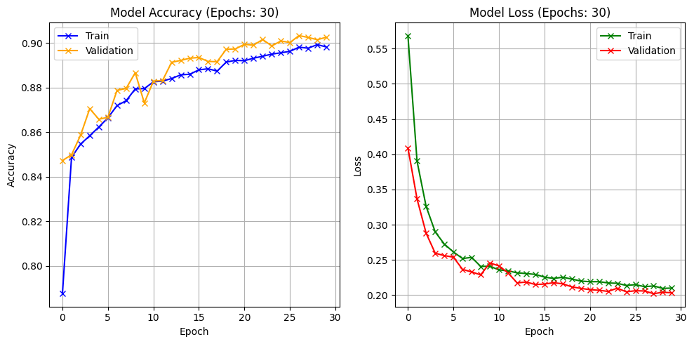
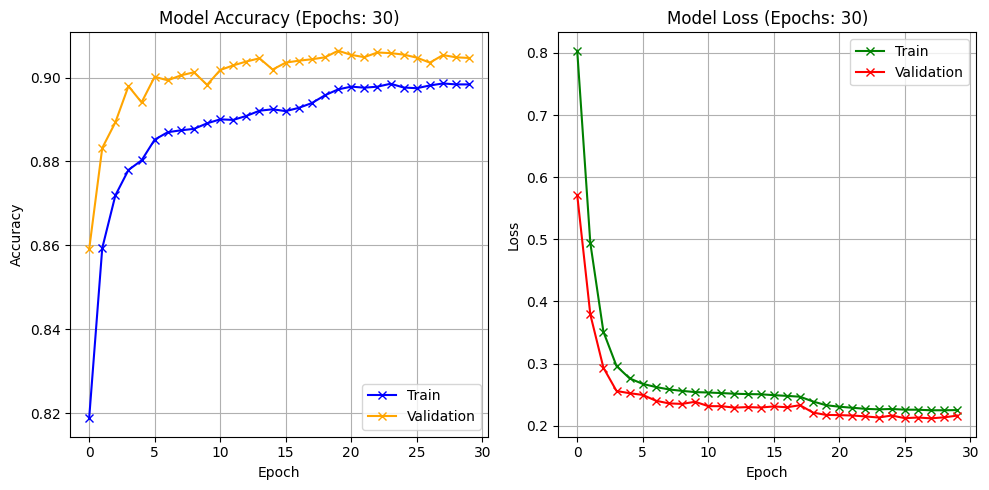
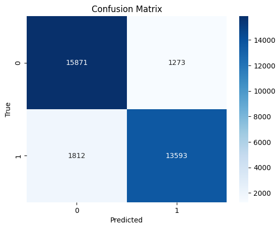
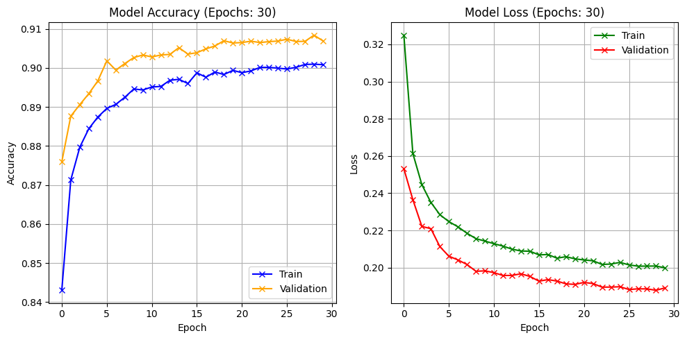
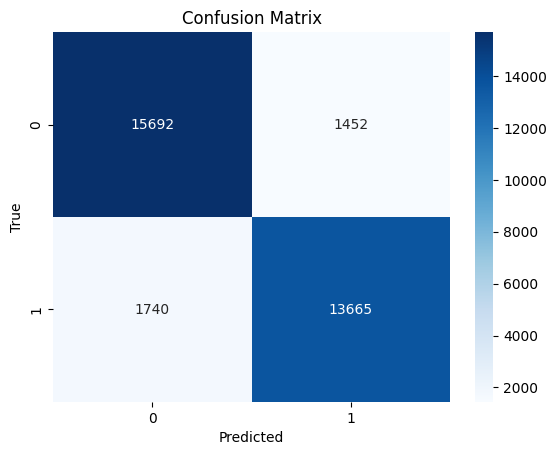

# Intrusion Detection with a Hybrid CNN-LSTM

Binary intrusion detection (normal vs. attack) on the [UNSW-NB15](https://research.unsw.edu.au/projects/unsw-nb15-dataset) dataset, comparing a 1D CNN, a stacked LSTM, and a hybrid CNN-LSTM. This started as my undergraduate thesis in Computer Science, and an earlier version was published in [Jurasik (Jurnal Riset Sistem Informasi dan Teknik Informatika)](https://tunasbangsa.ac.id/ejurnal/index.php/jurasik/article/view/895).

## Which notebook to use

Use `Corrected_TA_IDS.ipynb`.

`Original_Journal_Version_TA_IDS.ipynb` is the version behind the journal paper, and its 99.99% accuracy is not real. The `attack_cat` column (which is "Normal" exactly when the label is 0) and the row `id` were left in as features, and the data was resampled before the train/test split, so copies of the same rows ended up in both sets. I've kept it in the repo as a record of that mistake.

Here's what the same three models score once the leak is gone (test accuracy):

| Model    | Original (leaky) | Corrected |
|----------|-----------------:|----------:|
| CNN      | 0.9679           | 0.9052    |
| LSTM     | 1.0000           | 0.9019    |
| CNN-LSTM | 0.9999           | 0.9047    |

The training curves make the leak obvious. The journal LSTM hits 100% validation accuracy in its very first epoch, which no honest model does on this data.

<table>
  <tr>
    <th>Journal version (leaky)</th>
    <th>Corrected</th>
  </tr>
  <tr>
    <td></td>
    <td></td>
  </tr>
</table>

What the corrected notebook does differently:

- Drops `id` and `attack_cat`, then removes duplicate rows. About 37% of the combined dataset turned out to be duplicates once `id` was gone (257,673 → 162,745 rows).
- Splits into train, validation, and test sets (stratified) before any balancing.
- Balances only the training set, by upsampling whichever class is smaller, then shuffles it.
- Validates on its own held-out split instead of `validation_split`, so no upsampled copies leak into validation.

## Results

From the corrected notebook: a single run, evaluated on a test set of 32,549 rows that keeps the original class ratio.

| Model    | Accuracy | Weighted F1 | Benign recall | Attack recall |
|----------|---------:|------------:|--------------:|--------------:|
| CNN      | 0.9052   | 0.9051      | 0.93          | 0.88          |
| LSTM     | 0.9019   | 0.9019      | 0.92          | 0.89          |
| CNN-LSTM | 0.9047   | 0.9046      | 0.93          | 0.88          |

The three models end up within half a point of each other, so this run doesn't show the hybrid beating a plain CNN. All of them miss around 12% of attacks, and that's the number I'd work on first.

CNN-LSTM confusion matrix (0 = benign, 1 = attack) and training curves:

CNN and LSTM plots

## Running it

1. Download `UNSW_NB15_training-set.csv` and `UNSW_NB15_testing-set.csv` from the [UNSW-NB15 page](https://research.unsw.edu.au/projects/unsw-nb15-dataset).
2. Put both files in your Google Drive under `MyDrive/Colab Notebooks/Dataset/Training and Testing Sets/`.
3. Open the notebook in Colab, switch the runtime to a T4 GPU, and run all cells. It will ask to mount your Drive.

Training all three models takes roughly half an hour on a T4.

## How it works

The two CSV files are concatenated and deduplicated. `proto`, `service`, and `state` are label-encoded, and every feature is standardized with a scaler fitted on the training set only. Each flow becomes a sequence of 42 values with one channel, which is what the Conv1D and LSTM layers take as input.

The three models:

- **CNN**: three Conv1D blocks (64 filters, LeakyReLU, max pooling, dropout 0.3), followed by dense layers of 64 and 32 units.
- **LSTM**: two LSTM layers (128 and 64 units, dropout 0.5), then dense layers of 128 and 64 units with batch normalization.
- **CNN-LSTM**: three Conv1D blocks (128, 128, and 64 filters with kernel sizes 3, 2, and 1, plus batch normalization and L2), feeding into the same LSTM and dense stack as the LSTM model.

All three train with Adam (learning rate 5e-4), categorical cross-entropy, and batch size 64, for up to 30 epochs. Early stopping watches validation accuracy with patience 15, ReduceLROnPlateau halves the learning rate when validation loss stalls for 5 epochs, and the checkpoint with the best validation accuracy is used for evaluation.
